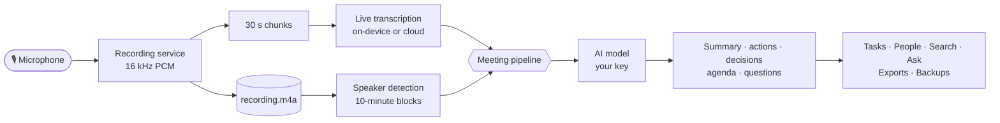

<div align="center">

# 🎙️ KaliScriber

**Your meetings, written up for you: recorded, transcribed, summarised and searchable, on your phone and on your own AI keys.**

[](https://github.com/sshahs/kaliscriber/releases/latest)
[](https://github.com/sshahs/kaliscriber/actions/workflows/android.yml)


[**Download**](#-install) · [Features](#-features) · [Privacy](#-privacy) · [AI services](#-ai-services) · [How it works](#-how-it-works) · [Build](#-build-it-yourself)

</div>

---

KaliScriber is an Android meeting note taker. Press record (or let your calendar or schedule do it), and when the meeting ends you get a transcript that knows who said what, a summary, action items with owners and due dates, decisions, and answers to anything you ask about it. Speech is transcribed **on the phone** by default, and the notes are written by the AI provider **you** choose, with **your** key.

## ✨ Highlights

- 🔒 **Private by design.** On-device transcription and speaker detection; only text goes to your chosen AI. No accounts, no servers of ours.
- 🗣️ **Knows who's talking.** Speakers are told apart on the phone, named from what they say, and remembered by voice in later meetings.
- 📝 **Notes that write themselves.** Summary, action items, decisions, highlights, risks and next steps, in a format that fits the meeting (1:1, stand-up, sales call, interview, lecture, or your own).
- 📅 **Records by itself.** Schedule recordings in the app, or let it record meetings from your calendar, from start to finish.
- 🔎 **Ask across everything.** "What did we decide about pricing last month?" gets an answer from all your meetings, with links to the exact moments.
- ✅ **Tasks that stay in step.** Every action item in one list, synced both ways with your CalDAV calendar (Baikal and others), and a **For you** part in each meeting with what you were asked and promised.
- 📁 **Projects.** Group meetings by project or client, with one page of its decisions, open actions and people, and questions answered from just its meetings.
- 🔁 **Your data, your way.** Export to Notion, AFFiNE, Google Docs, email, a Markdown folder (Obsidian) or CalDAV, with encrypted automatic backups.

## 📲 Install

Grab the latest APK from **[Releases](https://github.com/sshahs/kaliscriber/releases/latest)** and open it on your phone (Android 8.0 or later; allow installs from your browser or file manager).

| APK | For | Size |
|---|---|---|
| `arm64-v8a` | almost every phone from the last ten years | ~15 MB |
| `armeabi-v7a` | older 32-bit phones | ~14 MB |
| `universal` | if you're not sure | ~53 MB |
| `x86_64` | emulators and Intel/AMD devices | ~17 MB |

Every release is signed with the same key, so new versions install over old ones and keep your meetings.

<details>
<summary><b>Updating automatically with Obtainium</b></summary>

1. In [Obtainium](https://github.com/ImranR98/Obtainium), add `https://github.com/sshahs/kaliscriber`.
   For a self-hosted Gitea or Forgejo mirror, add its repository URL and choose **Codeberg (Forgejo)** under *Override source*. Without that, Obtainium treats the page as plain HTML and only ever sees one APK.
2. In the app's options, set **Filter APKs by regular expression** to `arm64-v8a\.apk$` (or turn on filtering by CPU architecture).
3. Leave **Include prereleases** off to get official releases only. Prereleases are the build of every commit.

</details>

**First run:** a short setup wizard walks you through choosing on-device or cloud transcription (and downloading the model), adding your AI key with a test, allowing the microphone and notifications, and a test recording.

## 🧩 Features

### 🎙️ Record and transcribe
- **Records with the screen off**, with a **live transcript** that updates every few seconds and a big, glanceable recording screen (timer, waveform, *Mark this moment*, hold-to-stop).
- **Bookmarks:** tap *Mark*, use the notification, or press play/pause on your headphones when something matters. Marked moments get extra weight in the notes.
- **Interruptions are noticed:** if a call or another app takes the microphone, the gap is marked in the transcript and the AI is told nothing was recorded.
- **Cleaner audio** with noise suppression, and a choice of microphone: phone, wired or USB headset, or Bluetooth.
- **Bring audio in:** share a recording, voice note or video to KaliScriber, import an audio file, or import a transcript from Zoom, Teams, Google Meet or Otter (WebVTT, SRT, Word or text).
- **One-tap recording** from a Quick Settings tile or a home-screen widget.

### 🗣️ Speakers
- **Speaker detection on the phone.** Until a speaker is named they get a placeholder (*Amber Falcon*). Rename, merge, move lines between speakers, or accept the AI's suggestion ("this is Priya, who introduced herself at 00:12").
- **Voice memory:** name someone once and they're recognised in later meetings. Voiceprints never leave the phone.
- **Speakers named as you go:** every ten minutes the live transcript is labelled with who's speaking.
- **Talk time:** each person's share of the talking, turns, questions and longest stretch.

### 📝 Notes
- **Insights:** summary, action items (owner, due date, priority), key points, decisions, highlights you can tap to replay, topics, risks, next steps and tone.
- **Summary formats** for 1:1s, stand-ups, sales calls, interviews and lectures, guessed from the meeting's title, plus **your own formats** with the sections you want, applied by title words.
- **Agenda:** give a meeting an agenda and the notes follow it, ticking each item covered or not with what was said.
- **Since last time:** recurring meetings show what the previous one decided and which of its actions are still open.
- **Gaps and questions:** the AI spots what's missing (tasks without owners, vague references, unanswered questions) and asks *you*; your answers improve the summary.
- **Glossary:** names and jargon that speech recognition gets wrong are spelled right in notes and fixed in transcripts, and with Parakeet the recogniser listens out for them as you record.
- **Share a clip** of a highlight, bookmark or lines as a small audio file with what was said.

### 📅 Schedule and calendar
- **Schedule tab:** record at set times, once or repeating (every day, weekdays, weekly or on chosen days, with an end date). Each schedule sets its notes format, number of people, a reminder and an agenda. Pause one, or everything until a date (holidays), and skip any occurrence.
- **Calendar auto-record:** recordings start when a calendar meeting begins and stop when it ends, from the phone's calendars (Google, Exchange…) or CalDAV. Late joins still start, back-to-back meetings get their own recordings, and you can keep recording past the end.
- **Meeting prep:** Home shows the meeting in progress or next, who's invited, what's still open with them and your last meeting together.
- **Next recording widget** with *Skip* and *Record now*.

> On Android 11 and later an app can only start recording by itself in the background if it may *display over other apps* (or, on the lock screen, show full-screen notifications). Without that, a notification asks you to tap *Record*. The Schedule tab shows what's missing.

### 🔎 Search and ask
- **Ask AI** about a meeting, or about selected lines. Answers cite timestamps, appear as they're written, and can be stopped.
- **Ask all meetings** with answers from everything you've recorded and links to the source moments. Narrow it by period, person, format or project. Optional **smart search** (a 30 MB on-device model) finds passages by meaning, not just words.
- **Search** titles, people, summaries, action items and every transcript line, matching word forms ("price" finds "pricing").
- **Find in transcript** with highlighted matches, or show one speaker's lines.
- **Weekly recap:** the week's meetings, decisions, themes, risks and follow-ups, with open actions by person; optionally as a Friday notification.

### ✅ Tasks, people and projects
- **Tasks:** every action item from every meeting, grouped by overdue, today, this week, later and no date. Tick, edit and filter by person, with an optional daily reminder.
- **For you:** set your name and each meeting's notes list what you were asked, what you promised and questions still waiting on you.
- **People pages** with each person's open tasks, notable quotes, meetings and talk time, plus one tap to ask about them.
- **Projects:** put meetings in a project from their summary, through a schedule, or by title words. Each project's page has its open actions, decisions, recent risks, next steps, people and meetings, and *Ask about this project* answers from just its meetings.

### 🎧 Listen and talk
- **Read aloud** a summary, an answer or a note.
- **Hands-free voice Q&A:** ask out loud and hear the answer sentence by sentence as it's written.
- **Audio briefing:** a one-to-two-minute spoken catch-up of a meeting to play or share.
- The phone's offline voice, or ElevenLabs.

### 📤 Export, sync and backup
| | |
|---|---|
| **Email** | the notes as text to your default recipients |
| **Google Docs** | opens the notes as a Word file in Docs; one-tap Drive upload optional |
| **Notion** | a page with headings, bullets and to-dos under a parent page |
| **AFFiNE** | a doc through the workspace MCP endpoint |
| **Baikal / CalDAV** | the meeting as an event and action items as tasks, **kept in step both ways** |
| **Markdown folder** | one note per meeting in a folder (an Obsidian vault, say), with properties, kept up to date |
| **Backups** | password-encrypted (AES-256-GCM) by hand or **automatically** every day or week into a folder, keeping the newest few |
| **Storage** | see what takes space and delete old recordings while keeping transcripts and notes |

### 🎨 Comfort
Light, dark or follow the phone, with wallpaper colours if you like. Undo instead of "are you sure?", errors that link to the fix, a notification when notes are ready, Settings in short searchable pages, screen-reader friendly controls, and a **problem report** (Settings → Problem report) that sends or saves a log of what the app did when something goes wrong.

## 🔒 Privacy

| What | Where it goes |
|---|---|
| Audio | stays on the phone with on-device transcription (the default); sent only to your speech provider if you choose a cloud one |
| Transcripts, notes, voiceprints | stored only on the phone |
| Text for summaries and answers | sent only to the AI provider you picked, with your key; optionally with email addresses, phone and card numbers and names you list **swapped for placeholders**, which are put back in what comes back |
| API keys and passwords | encrypted with the Android Keystore, sent only to their own service, never put in backups |
| Backups | encrypted with your password, written only where you choose; Android's own cloud backup is off |
| Problem reports | a log of what the app did, kept on the phone; sent only if you send it, without keys, passwords, email addresses or meeting content |

There is no KaliScriber server and no account.

## 🧠 On-device speech

Transcription runs on the phone with [sherpa-onnx](https://github.com/k2-fsa/sherpa-onnx). Download a model once in **Settings → Speech & voices**:

| Model | Languages | Download |
|---|---|---|
| **Parakeet TDT 0.6B v3** (recommended) | 25 European languages incl. English | 465 MB |
| Parakeet TDT 0.6B v2 | English | 460 MB |
| Whisper Base / Tiny / Small | 99 languages | 198 / 111 / 610 MB |
| SenseVoice | Chinese, Cantonese, English, Japanese, Korean | 155 MB |

Silero VAD (1 MB) splits audio into utterances, and a 47 MB **speaker pack** (pyannote segmentation plus NeMo TitaNet) tells voices apart. Recordings are processed in ten-minute blocks while you record; every speaker gets a voiceprint, and voiceprints are matched across blocks, which also rejoins one person the diarizer split in two. Lines are split at the word where the speaker changes. Prefer the cloud? Switch to ElevenLabs Scribe or any provider below.

## 🤖 AI services

Bring your own key for any of these. Every base URL and model is editable, and *List models* and *List voices* show what your key can use.

| Provider | Notes & chat | Transcription | Voice |
|---|---|---|---|
| **On-device (sherpa-onnx)** | | ✓ default, with speakers | phone voice |
| **Command Code** | ✓ with **zero data retention** (on by default) | | |
| **ElevenLabs** | | ✓ Scribe, with speakers | ✓ |
| OpenAI | ✓ | ✓ (`gpt-4o-transcribe-diarize` labels speakers) | |
| Anthropic Claude | ✓ | | |
| Google Gemini | ✓ | | |
| Ollama Cloud | ✓ | | |
| Groq, Mistral | ✓ | ✓ | |
| OpenRouter, DeepSeek | ✓ | | |
| Deepgram, AssemblyAI | | ✓ with speakers | |
| Any OpenAI-compatible server | ✓ | ✓ | |

<details>
<summary>Details for Command Code, models per task and costs</summary>

- **Command Code** uses the Provider API at `https://api.commandcode.ai/provider/v1` (a plan with API access is needed): Claude models over the Anthropic Messages wire, others over Chat Completions. With **ZDR** on, every request carries `x-cmd-zdr: 1`, so only upstreams that keep nothing are used, and a model without such a route fails clearly instead of silently falling back.
- **A quick model for background work:** running notes, speaker names, glossary fixes and search words can use a smaller, cheaper model while summaries and answers keep the main one.
- **Usage and cost:** Settings shows tokens per model this month and, once you enter prices, the cost; each meeting lists what its requests used.

</details>

## ⚡ Why it's fast

- **Work happens while you record:** speakers are detected every ten minutes and the AI keeps running notes, so a long meeting's summary is ready soon after you stop.
- **Streaming answers** appear as they're written.
- **Prompt caching:** every request about a meeting starts with the same text, so providers that cache prompts (DeepSeek, OpenAI, Gemini, and Claude with explicit cache markers) answer follow-ups faster and cheaper.
- **Light storage:** transcripts stay on disk until opened, and search uses an on-device SQLite full-text index, so hundreds of meetings stay quick.
- **Optimised release build** with R8.

## 🛠️ How it works



| Module | What's in it |
|---|---|
| `core/` | plain Kotlin/JVM: provider clients (OkHttp, kotlinx.serialization), prompts, speaker logic, the meeting pipeline, scheduling, sync and storage, with unit tests (MockWebServer) |
| `app/` | the Android app in Jetpack Compose and Material 3: recording service and audio engine, on-device speech, Keystore secrets, widgets, workers and screens |

## 🧪 Build it yourself

You need JDK 17+ and the Android SDK (API 35). The first build downloads the sherpa-onnx AAR (50 MB, checksum-verified) into `app/libs/`.

```bash
./gradlew :core:test           # unit tests for the AI, pipeline and sync layers
./gradlew :app:assembleDebug   # app/build/outputs/apk/debug/app-debug.apk
```

<details>
<summary><b>Releases and signing</b></summary>

GitHub Actions runs the tests and builds the APKs on every push. Pushes to `main` are published as prereleases (`build-<N>`), and official releases (`v<version>`) are published by running the workflow with *publish*, using the notes in `.github/release-notes/`.

Releases are signed with the key in the `KALISCRIBER_KEYSTORE_BASE64` (a base64 keystore with alias `kaliscriber`) and `KALISCRIBER_KEYSTORE_PASSWORD` repository secrets. Every APK is checked against the certificate in `.github/signing-cert-sha256` before it's published, so a build signed with any other key (which wouldn't install as an update) is never released. Without the secrets, builds use a temporary key and nothing is published.

</details>

<details>
<summary><b>Building on Gitea with act_runner</b></summary>

`.gitea/workflows/android.yml` builds the app on a Gitea instance with [act_runner](https://docs.gitea.com/usage/actions/act-runner), for example on a pull mirror of this repository. Each mirror sync that brings new commits runs the tests and builds the APKs, which you can download from the run. Gitea uses `.gitea/workflows` and ignores `.github/workflows` when that directory exists.

1. **Enable Actions** on the repository (Settings → Repository → Actions) and on the instance.
2. **Register a runner** with an `ubuntu-latest` label pointing at an image with Node.js, such as `ubuntu-latest:docker://gitea/runner-images:ubuntu-latest` (act_runner's default). The workflow installs Java 17 and the Android SDK itself. A build needs about 4 GB of memory and access to Maven Central, Google's Maven repository and GitHub.
3. **Add the same signing secrets** as on GitHub under the repository's Settings → Actions → Secrets. Without them builds use a throwaway key and nothing is published.

When the mirror brings a `v<version>` tag, the Gitea build of that tag publishes a release on it in the Gitea repository, with the APKs and links to the Gitea commit and run. Gitea never creates tags of its own (a pull mirror deletes local tags at its next sync), so builds started by hand or from a branch produce artifacts only.

</details>

<details>
<summary><b>Export setup</b></summary>

| Target | What you need |
|---|---|
| Notion | an internal integration secret (notion.so/profile/integrations), with the parent page connected to it |
| AFFiNE | the workspace id and a read-write MCP token (workspace settings → Integrations → MCP Server) |
| Baikal / CalDAV | a calendar URL such as `https://<server>/dav.php/calendars/<user>/<calendar>/`, a username and a password (Basic and Digest auth work) |
| Google Docs upload | optional: an Android OAuth client for `com.kaliscriber.app` with the SHA-1 shown in Settings, and the Drive API enabled; without it notes open in Docs as a Word file |

</details>
